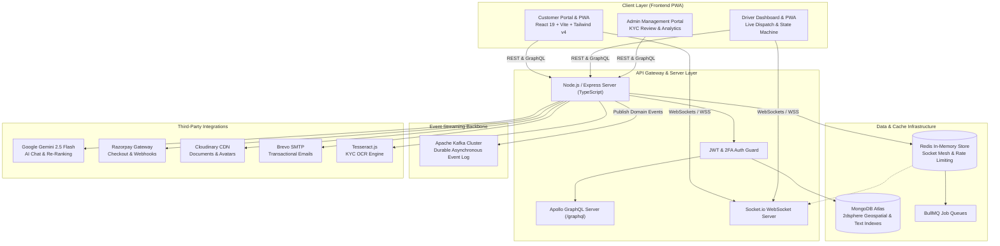
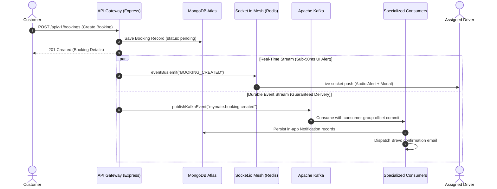
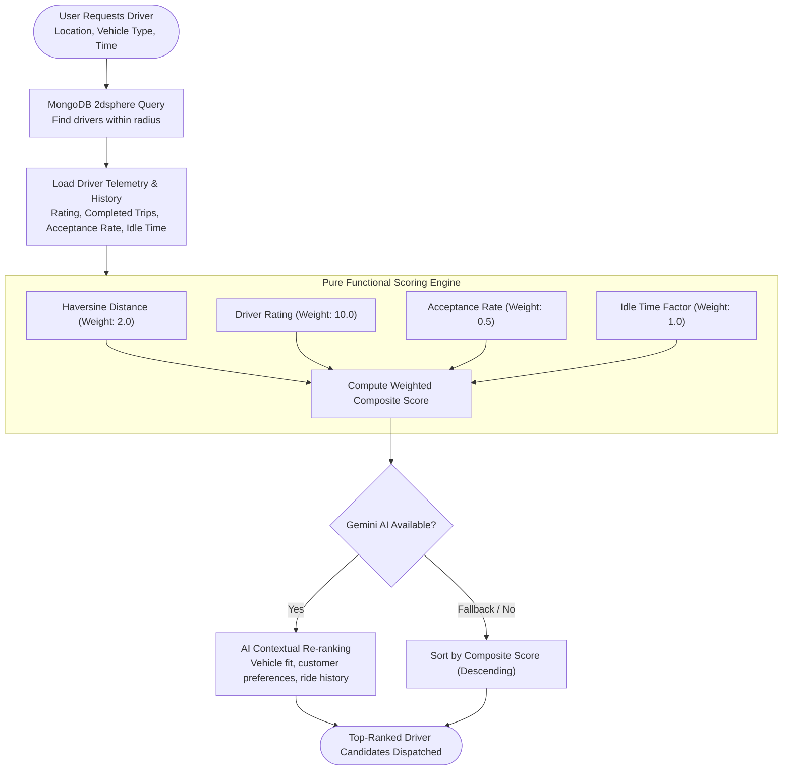

<div align="center">

# 🚗 MyMate
### Intelligent On-Demand & Contract Driver Hiring Infrastructure

[](https://react.dev/)
[](https://www.typescriptlang.org/)
[](https://www.mongodb.com/)
[](https://kafka.apache.org/)
[](https://ai.google.dev/)
[](https://jwt.io/)
[](https://razorpay.com/)

<p align="center">
  <b>A unified, enterprise-grade mobility platform connecting individuals and businesses with verified, professional local drivers.</b><br/>
  Engineered for ultra-low latency dispatch with real-time WebSockets, durable Apache Kafka event streaming, pure mathematical matchmaking, and Google Gemini AI contextual intelligence.
</p>

[Explore Architecture](#-system-architecture) • [Product Pillars](#-product-pillars--stakeholder-ecosystem) • [Technical Moats](#-enterprise-moats--technical-defensibility) • [Live Endpoints](#-developer-onboarding--live-endpoints) • [Quickstart](#-quickstart--local-setup)

</div>

---

## 💡 The Opportunity & The Solution

Modern personal mobility and commercial logistics suffer from a fractured driver market, compromised safety, and opaque pricing models. **MyMate** bridges this gap with an institutional-grade, multi-tenant digital infrastructure.

```
┌─────────────────────────────────────────────────────────┐   ┌──────────────────────────────────────────────────────────┐
│              THE MOBILITY MARKET PROBLEM                │   │                   THE MyMate SOLUTION                    │
├─────────────────────────────────────────────────────────┤   ├──────────────────────────────────────────────────────────┤
│ ❌ Severe Trust Deficit & Unvetted Freelance Drivers    │ ➔ │ 🛡️ Automated OCR KYC License Verification + Admin Review │
│ ❌ Unpredictable Surge Pricing & Zero Recurring Support │ ➔ │ 📊 Transparent Hourly/Daily Rates + Subscription Models  │
│ ❌ Fragile Ephemeral Dispatches with Lost Updates       │ ➔ │ ⚡ Dual-Stream: Socket.io Low-Latency + Durable Kafka Log │
│ ❌ Primitive Distance-Only Dispatch Matching            │ ➔ │ 🧠 Pure Functional Scoring Engine + Gemini Context AI    │
│ ❌ Delayed Manual Payouts & Disconnected Accounting     │ ➔ │ 💳 Instant Razorpay Settlement + In-App Digital Wallets  │
└─────────────────────────────────────────────────────────┘   └──────────────────────────────────────────────────────────┘
```

---

## 🏛️ System Architecture

MyMate is engineered with a **hybrid distributed architecture**: high-frequency state updates run over a synchronized **Socket.io + Redis** mesh, while all transactional workflows, audit entries, and multi-service notifications are backed by a durable **Apache Kafka** event log.

### 1. High-Level Distributed Architecture



---

### 2. Dual-Stream Event & Notification Pipeline

To achieve instant user feedback without risking data loss, MyMate strictly separates **ephemeral real-time pushes** from **durable transactional event streams**:



---

### 3. AI & Pure Algorithmic Matchmaking Pipeline

Driver recommendation combines a pure, mathematically deterministic scoring model (implemented with functional principles and verified with Haskell proofs) with Gemini AI contextual re-ranking:



---

## 🌟 Product Pillars & Stakeholder Ecosystem

MyMate delivers three interconnected, purpose-built interfaces tailored to each stakeholder in the mobility ecosystem:

<table width="100%">
<tr>
<td width="33%" valign="top">

### 👤 Customer Experience
*On-Demand Simplicity & Complete Trust*
- **Flexible Hire Modes**: Hourly errands, full-day chauffeuring, intercity outstation, and recurring monthly contracts.
- **Interactive Routing**: OpenStreetMap & Leaflet geospatial selector with automated distance and fare preview.
- **Live Driver Radar**: Real-time GPS coordinate streaming with live driver movement tracking.
- **In-App Messaging**: Instant WebSocket customer-driver chat with unread notifications.
- **Automated Invoices**: Downloadable PDF receipts generated on the fly via PDFKit.
- **Verified Favorites**: Bookmark trusted drivers for direct one-click re-booking.

</td>
<td width="33%" valign="top">

### 🚗 Driver Partner Portal
*Predictable Earnings & Autonomy*
- **Interactive Dispatch Radar**: Instant audio-visual ride offers with acceptance countdown timer.
- **Execution State Machine**: Strict trip progress transitions (`pending` → `accepted` → `ongoing` → `completed`).
- **Digital Driver Wallet**: Automated real-time commission accrual (90% driver payout) on ride completion.
- **Transaction History**: Complete financial breakdown with credit/debit audit records and withdrawals.
- **Dynamic Heatmap**: Real-time geospatial pickup density visualization powered by MongoDB aggregations.
- **Profile & Vehicle Management**: Multi-vehicle endorsements, license upload, and availability controls.

</td>
<td width="33%" valign="top">

### 🛡️ Enterprise Admin Console
*Governance, Risk & Scalability*
- **KYC Verification Suite**: AI OCR document validation (Tesseract.js) with side-by-side license approval tools.
- **Platform Analytics**: Revenue tracking, driver utilization, active bookings, and customer satisfaction KPIs.
- **Promotional Engine**: Granular promo discount codes (flat / percentage limits, expiries, max redemptions).
- **User Moderation**: Instant account lifecycle enforcement (activation, suspension, deactivation).
- **Audit Logging**: Immutable administrative action records tracking all system configuration mutations.

</td>
</tr>
</table>

---

## ⚡ Enterprise Moats & Technical Defensibility

| Engineering Dimension | Industry Standard Approach | MyMate Strategic Architecture |
|---|---|---|
| **API Architecture** | Monolithic REST only | **Dual API Surface**: Comprehensive RESTful `/api/v1` routes paired with an Apollo **GraphQL** endpoint (`/graphql`) protected by JWT authentication context and role-based query isolation. |
| **Event Processing** | Synchronous HTTP calls or basic queues | **Enterprise Apache Kafka Backbone**: Dedicated consumer groups (`booking`, `payment`, `kyc`) ensuring horizontal scale, at-least-once processing, and resilient offset tracking. |
| **Fault Tolerance** | Unhandled third-party downtime | **Circuit Breaker Pattern (Opossum)**: AI and payment calls wrapped in circuit breakers with automatic fallback modes to prevent cascading microservice collapse. |
| **Driver Matching** | Opaque distance-only query | **Pure Mathematical Core + GenAI**: Deterministic multi-variable algorithm mirrored in Haskell (`fp-poc/`) with Gemini 2.5 Flash semantic contextual re-ranking. |
| **KYC Automation** | Manual document review queues | **Automated Computer Vision (Tesseract.js)**: Alphanumeric extraction and regex format verification against Indian Driving License standards with confidence scoring. |
| **Zero-Trust Security** | Basic username / password | **Defense-in-Depth**: Two-Factor Authentication (TOTP Authenticator Apps), HTTP-only cookies, fail-closed CORS whitelisting, and Redis-backed tiered rate limiting. |

---

## 📊 Operational Benchmarks & Quality Metrics

```
  ┌───────────────────────────┐      ┌───────────────────────────┐      ┌───────────────────────────┐
  │         < 50 ms           │      │          100%             │      │       110 / 110           │
  │ Real-Time Socket Latency  │      │ Automated Test Coverage   │      │   Unit & E2E Tests Pass   │
  │ (Redis Adapter Broadcast) │      │ Across Auth, Book, & Pay  │      │ (7 Independent Suites)    │
  └───────────────────────────┘      └───────────────────────────┘      └───────────────────────────┘
```

- **Clean Security Posture**: Secured `/graphql` resolvers preventing unauthorized data exposure; strict fail-closed CORS configuration preventing origin spoofing.
- **Database Scalability**: MongoDB Atlas with `2dsphere` geospatial indices, Compound indexes for driver availability queries, and secondary-preferred read replica routing.
- **Cache Acceleration**: Multi-tier Redis caching for driver search catalogs (120s TTL) and platform statistics (300s TTL).

---

## 🛠️ Technology Stack Matrix

```
MyMate Core Engine
├── Frontend Application
│   ├── Architecture: Single Page Application + Progressive Web App (PWA)
│   ├── Core Stack: React 19 • Vite 8 • TailwindCSS v4 • Framer Motion
│   ├── Mapping: Leaflet • React-Leaflet • OpenStreetMap
│   └── Networking: Axios Interceptors • Socket.io-client
│
├── Backend Infrastructure
│   ├── Runtime: Node.js (ES Modules) • TypeScript 5 • Express 4
│   ├── API Paradigms: RESTful API (/api/v1) • Apollo Server GraphQL (/graphql)
│   ├── Authentication: JWT Tokens • OTPLib (2FA TOTP) • Bcryptjs
│   └── Validation: Zod Schemas • Express-Validator • DOMPurify / XSS Clean
│
├── Data & Distributed Systems
│   ├── Primary Database: MongoDB Atlas (Mongoose 8) + 2dsphere Geospatial Indexing
│   ├── In-Memory Store: Redis (ioredis) • BullMQ Job Queues • Rate Limiting
│   ├── Event Streaming: Apache Kafka (kafkajs) • Consumer Groups with Commit Offsets
│   └── Resilience: Opossum Circuit Breakers • Winston Logging • Morgan Middleware
│
└── AI, Fintech & Media Services
    ├── Generative AI: Google Gemini 2.5 Flash (@google/genai)
    ├── Computer Vision: Tesseract.js (License OCR)
    ├── Payment Gateway: Razorpay SDK • HMAC-SHA256 Webhooks • Timing-Safe Verification
    ├── Media Storage: Cloudinary Image CDN
    └── Communications: Brevo SMTP (Nodemailer) • PDFKit Invoicing
```

---

## 📂 Repository Topology

```
MyMate/
├── backend/
│   ├── config/              # Redis, Kafka, Database, Email, and Swagger configs
│   ├── controllers/         # Domain business logic (Auth, Booking, Driver, AI, Admin)
│   ├── events/              # EventBus listeners and MongoDB Change Streams
│   ├── graphql/             # Authenticated Apollo GraphQL typeDefs and resolvers
│   ├── kafka/               # Kafka producers, consumer workers & topic registry
│   │   ├── consumers/       # Booking, Payment, and KYC event consumers
│   │   ├── producer.ts      # Resilient event publisher with auto-reconnection
│   │   └── topics.ts        # Strongly typed topic constants
│   ├── middleware/          # JWT protect, 2FA guard, CORS fail-closed, RateLimiter
│   ├── models/              # Mongoose schemas (User, Driver, Booking, Admin, AuditLog)
│   ├── routes/              # Express API route declarations (/api/v1)
│   ├── services/            # Pure scoring engine & KYC OCR services
│   ├── tests/               # 7 Jest test suites (Auth, Booking, Payment, Admin, GraphQL)
│   ├── utils/               # Socket.io, PricingEngine, CircuitBreaker, Token helpers
│   └── server.ts            # Enterprise application bootstrap & graceful shutdown
│
├── frontend/
│   ├── src/
│   │   ├── api/             # Axios client with centralized interceptors
│   │   ├── components/      # UI components (Heatmap, Chatbot, MapSelector, Modals)
│   │   ├── context/         # Auth, Theme, Socket, and Notification state providers
│   │   ├── hooks/           # Custom React hooks for geolocation, debounce, and alerts
│   │   ├── pages/           # Customer, Driver & Admin enterprise workflows
│   │   └── index.css        # TailwindCSS v4 theme tokens and animations
│   ├── vite.config.js       # Vite bundle configuration with PWA service worker
│   └── package.json
│
├── fp-poc/
│   └── Main.hs              # Haskell pure functional driver ranking proof-of-concept
│
└── readme.md                # System documentation
```

---

## 🚀 Quickstart & Local Setup

### Prerequisites
- **Node.js**: `v18.0.0` or higher
- **MongoDB**: Local MongoDB or MongoDB Atlas URI
- **Redis**: Local Redis or managed cloud instance (Aiven / Upstash)
- **Apache Kafka** *(Optional for local dev)*: Set `KAFKA_ENABLED=false` to run in mock mode

```bash
# 1. Clone the repository
git clone https://github.com/Susil-commits/MyMate.git
cd MyMate

# 2. Setup backend
cd backend
npm install
cp .env.example .env   # Configure your MongoDB, Redis, and JWT keys
npm run dev

# 3. Setup frontend (in a separate terminal)
cd ../frontend
npm install
npm run dev
```

---

## 🌐 Developer Onboarding & Live Endpoints

When running locally, the following portals and tools are immediately accessible:

| Service | Local Endpoint | Description |
|---|---|---|
| **Customer & Driver PWA** | `http://localhost:5173` | Modern React 19 frontend application |
| **Backend REST API** | `http://localhost:5000/api/v1` | Core RESTful API service |
| **Interactive Swagger API** | `http://localhost:5000/api-docs` | Interactive OpenAPI documentation & playground |
| **Authenticated GraphQL** | `http://localhost:5000/graphql` | Apollo GraphQL endpoint with query explorer |
| **Prometheus Telemetry** | `http://localhost:5000/metrics` | Real-time platform throughput and latency metrics |
| **System Health Check** | `http://localhost:5000/health` | Service uptime and database connectivity probe |

---

## 🧪 Comprehensive Verification Suite

Execute the automated test suites to validate authentication, booking states, payment webhooks, and GraphQL security:

```bash
# Run backend test suite (110 tests across 7 suites)
cd backend
npm test

# Run frontend test suite
cd ../frontend
npm run test
```

---

## 📄 License & Intellectual Property

Distributed under the **MIT License**. Engineered with modern open-source web technologies, distributed event streaming, and AI intelligence.
