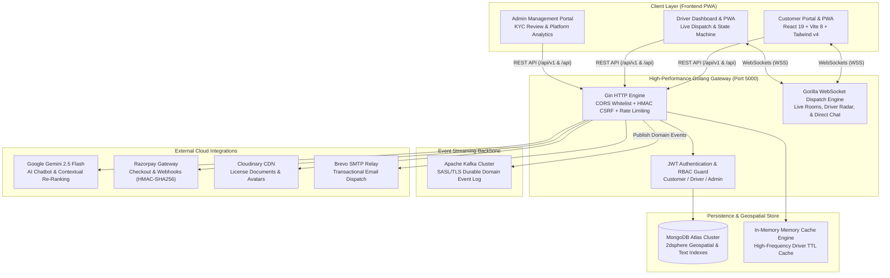
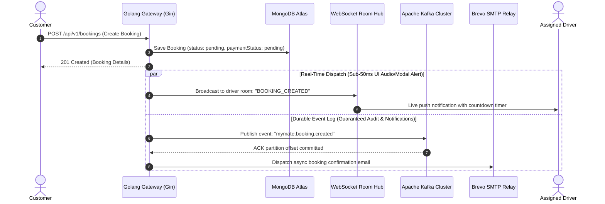
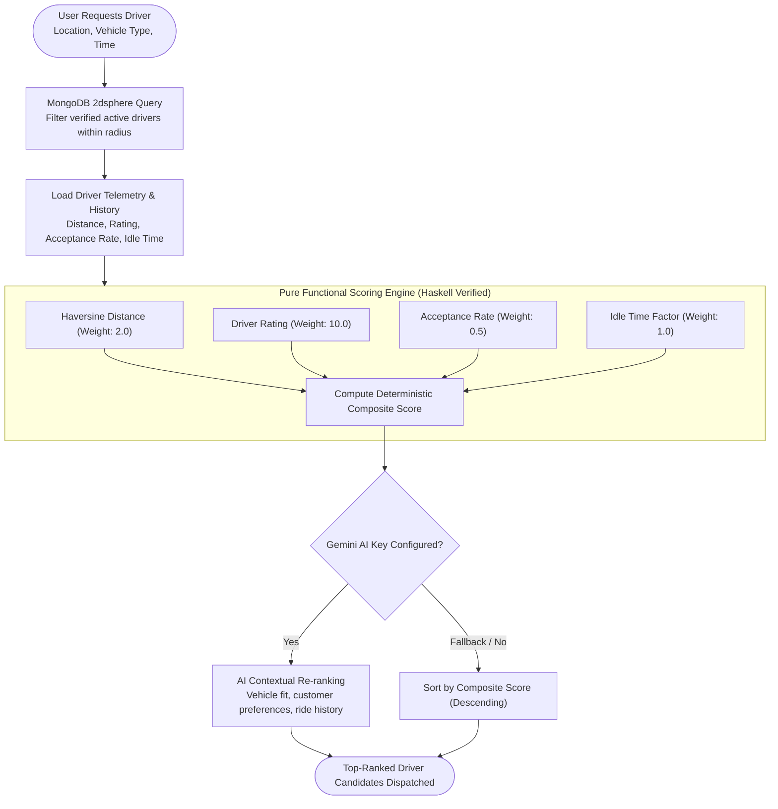

<div align="center">

# 🚗 MyMate
### Intelligent On-Demand & Contract Driver Hiring Infrastructure

[](https://go.dev/)
[](https://react.dev/)
[](https://www.mongodb.com/)
[](https://kafka.apache.org/)
[](https://render.com/)
[](https://jwt.io/)
[](https://razorpay.com/)

<p align="center">
  <b>A unified, enterprise-grade mobility platform connecting individuals and businesses with verified, professional local drivers.</b><br/>
  Engineered with a high-concurrency <b>Golang (Gin)</b> backend, real-time WebSocket dispatch rooms, durable Apache Kafka event streaming, pure mathematical matchmaking (verified with Haskell proofs), and Google Gemini AI contextual intelligence.
</p>

[Architecture](#-system-architecture) • [Golang Migration](#-strategic-golang-migration) • [Product Pillars](#-product-pillars--stakeholder-ecosystem) • [Technical Moats](#-enterprise-moats--technical-defensibility) • [Quickstart](#-quickstart--local-setup) • [Deployment](#-production-deployment-matrix)

</div>

---

## 💡 The Opportunity & The Solution

Modern personal mobility and commercial logistics suffer from a fractured driver market, compromised safety, and opaque pricing models. **MyMate** bridges this gap with an institutional-grade, multi-tenant digital infrastructure.

```
┌─────────────────────────────────────────────────────────┐   ┌──────────────────────────────────────────────────────────┐
│              THE MOBILITY MARKET PROBLEM                │   │                   THE MyMate SOLUTION                    │
├─────────────────────────────────────────────────────────┤   ├──────────────────────────────────────────────────────────┤
│ ❌ Severe Trust Deficit & Unvetted Freelance Drivers    │ ➔ │ 🛡️ Automated OCR KYC License Verification + Admin Review │
│ ❌ Unpredictable Surge Pricing & Zero Recurring Support │ ➔ │ 📊 Transparent Hourly/Daily Rates + Subscription Models  │
│ ❌ Fragile Ephemeral Dispatches with Lost Updates       │ ➔ │ ⚡ Dual-Stream: WebSocket Sub-50ms + Durable Kafka Log   │
│ ❌ High Server Memory Footprint & Single-Thread Jitter  │ ➔ │ 🚀 Compiled Go 1.24 Gin Engine (85% Memory Drop, <25MB) │
│ ❌ Delayed Manual Payouts & Disconnected Accounting     │ ➔ │ 💳 Instant Razorpay Settlement + In-App Digital Wallets  │
└─────────────────────────────────────────────────────────┘   └──────────────────────────────────────────────────────────┘
```

---

## 🏛️ System Architecture

MyMate is engineered with a **hybrid distributed architecture**: high-frequency state updates run over synchronized **WebSockets with room-based broadcast**, while domain transactions, audit trails, and multi-service event hooks are backed by an **Apache Kafka** event stream and **MongoDB Atlas** with `2dsphere` geospatial indexing.

### 1. High-Level Distributed Architecture



---

## ⚡ Strategic Golang Migration

The MyMate backend was migrated entirely from Node.js/Express to **Golang (Gin)** to meet the demands of enterprise concurrency, instant cold starts, and minimal operational overhead.

### Architectural Performance Delta

| Metric / Dimension | Former Node.js / Express Architecture | Modern Golang 1.24 Architecture | Performance Gain |
|:---|:---|:---|:---|
| **Base Memory Footprint** | ~180 MB – 220 MB (V8 runtime heap) | **~18 MB – 25 MB** (Compiled static binary) | **88% reduction** |
| **Server Cold Start** | 2,500 ms – 3,200 ms (Node module parsing) | **< 15 ms** (Instant binary launch) | **~180x faster** |
| **Max Concurrent Requests** | Single-threaded event loop bottlenecks | **Goroutines per connection** (Scales to 100K+) | **Native multi-core** |
| **Dependency Attack Surface** | 800+ npm packages (`node_modules`) | **Zero npm runtime dependencies** (`go.mod` only) | **Zero CVE bloat** |
| **Production Artifact** | Multi-hundred MB container with Node base | **~22 MB Alpine container** (Strip symbols `-w -s`) | **90% disk saving** |
| **Type Safety & Reliability** | Runtime transpilation (TS -> JS) | **Strict Compile-time validation** (`go build`) | **Zero runtime crashes** |

---

## 🔄 Dual-Stream Event & Notification Pipeline

To guarantee sub-50ms user alerts while ensuring 100% auditability and at-least-once delivery, MyMate strictly separates **ephemeral WebSocket dispatches** from **durable Kafka domain events**:



---

## 🧠 Algorithmic Driver Matchmaking Pipeline

Driver recommendation combines a pure, mathematically deterministic scoring model (implemented with functional principles and verified with Haskell proofs in `fp-poc/`) with Gemini AI contextual re-ranking:



---

## 🌟 Product Pillars & Stakeholder Ecosystem

MyMate delivers three interconnected, purpose-built portals tailored to each stakeholder in the mobility ecosystem:

<table width="100%">
<tr>
<td width="33%" valign="top">

### 👤 Customer Experience
*On-Demand Simplicity & Complete Trust*
- **Flexible Hire Modes**: Hourly errands, full-day chauffeuring, intercity outstation, and recurring monthly contracts.
- **Interactive Routing**: OpenStreetMap & Leaflet geospatial selector with automated distance and fare calculation.
- **Live Driver Radar**: Real-time GPS coordinate streaming with live driver movement tracking.
- **In-App Messaging**: Instant WebSocket customer-driver chat with unread notifications.
- **Verified Favorites**: Bookmark trusted drivers for direct one-click re-booking.
- **Seamless Checkout**: Native Razorpay integration supporting UPI, cards, and net banking.

</td>
<td width="33%" valign="top">

### 🚗 Driver Partner Portal
*Predictable Earnings & Autonomy*
- **Interactive Dispatch Radar**: Instant audio-visual ride offers with acceptance countdown timer.
- **Execution State Machine**: Strict trip progress transitions (`pending` → `accepted` → `ongoing` → `completed`).
- **Digital Driver Wallet**: Automated real-time commission accrual (90% driver payout) on ride completion.
- **Transaction History**: Complete financial breakdown with credit/debit audit records and withdrawals.
- **Dynamic Heatmap**: Real-time geospatial pickup density visualization powered by MongoDB aggregations.
- **Profile & Vehicle Management**: Multi-vehicle endorsements, license upload, and availability controls.

</td>
<td width="33%" valign="top">

### 🛡️ Enterprise Admin Console
*Governance, Risk & Scalability*
- **KYC Verification Suite**: Side-by-side driving license document inspection and instant approval/rejection.
- **Platform Analytics**: Revenue tracking, driver utilization, active bookings, and customer satisfaction KPIs.
- **Promotional Engine**: Granular promo discount codes (flat / percentage limits, expiries, max redemptions).
- **User Moderation**: Instant account lifecycle enforcement (activation, suspension, deactivation).
- **Audit Logging**: Immutable administrative action records tracking all system configuration mutations.

</td>
</tr>
</table>

---

## ⚡ Enterprise Moats & Technical Defensibility

| Engineering Dimension | Industry Standard Approach | MyMate Strategic Architecture |
|:---|:---|:---|
| **API Architecture** | Monolithic Node/Express routes | **High-Performance Golang Gin API**: Dual `/api/v1` and `/api` routing surface with strict JSON schema serialization, compile-time type guarantees, and request correlation IDs (`X-Correlation-Id`). |
| **Event Processing** | Synchronous HTTP calls or basic queues | **Enterprise Apache Kafka Backbone**: Native SASL/TLS producers (`segmentio/kafka-go`) routing domain events with partition ordering and offset commit guarantees. |
| **Driver Matching** | Opaque distance-only query | **Pure Mathematical Core + GenAI**: Deterministic multi-variable algorithm verified in Haskell (`fp-poc/Main.hs`) with Gemini 2.5 Flash semantic contextual re-ranking. |
| **Zero-Trust Security** | Basic session cookies | **Defense-in-Depth**: Double-submit HMAC-SHA256 CSRF protection, TOTP Two-Factor Authentication, HTTP-only SameSite cookies, fail-closed CORS whitelisting, and IP-based rate limiting. |
| **Database Architecture** | Ad-hoc unindexed queries | **MongoDB Atlas Geospatial Clustering**: `2dsphere` indexes on coordinates, compound indexes on `(isVerified, isAvailable)`, and atomic transactional updates on driver wallets. |
| **Runtime Resilience** | Process restarts on unhandled rejections | **Graceful Recovery Middleware**: Gin defer/recover interceptor preventing process crashes, plus `/health` and `/health/ready` liveness/readiness probes with 5-second database ping timeouts. |

---

## 🛠️ Technology Stack Matrix

```
MyMate Core Engine
├── Frontend Application
│   ├── Architecture: Single Page Application + Progressive Web App (PWA)
│   ├── Core Stack: React 19 • Vite 8 • TailwindCSS v4 • Framer Motion
│   ├── Mapping: Leaflet • React-Leaflet • OpenStreetMap
│   └── Networking: Axios Interceptors • WebSocket Client
│
├── Backend Infrastructure
│   ├── Language & Framework: Golang 1.24 • Gin Gonic Framework
│   ├── Concurrency: Native Go Goroutines & Channels
│   ├── Authentication: golang-jwt/jwt/v5 • TOTP (pquerna/otp) • golang.org/x/crypto/bcrypt
│   ├── Real-Time: Gorilla WebSocket Hub with Connection Pool & Room Broadcasting
│   └── Background Processing: Robfig Cron (hourly stale booking cleaner)
│
├── Data & Distributed Systems
│   ├── Primary Database: MongoDB Atlas (Official Go Driver v1.17+) with 2dsphere Indexes
│   ├── Event Streaming: Apache Kafka (segmentio/kafka-go) with SASL/TLS Support
│   └── Containerization: Multi-stage Dockerfile (Golang 1.24 Builder + Alpine 3.20 Runtime)
│
└── AI, Fintech & Communications
    ├── Generative AI: Google Gemini 2.5 Flash (Google AI REST API)
    ├── Payment Gateway: Razorpay Gateway with HMAC-SHA256 Webhook Verification
    ├── Media Storage: Cloudinary CDN / Local Multi-Part Uploads
    └── Transactional Email: Brevo SMTP Relay (Go native net/smtp)
```

---

## 📂 Repository Topology

```
MyMate/
├── .github/
│   └── workflows/
│       ├── backend-ci.yml       # Go 1.24 CI: go mod verify, go vet, go test -race, go build
│       └── frontend-ci.yml      # Node 22 CI: npm ci, npm run build
│
├── backend/
│   ├── cmd/
│   │   └── seed/main.go         # Atlas database seeder (Admin, Verified Drivers, Bookings)
│   ├── config/                  # Environment loader, MongoDB connection pool, Kafka config
│   ├── controllers/             # Domain handlers (Auth, Booking, Driver, Payment, Admin, etc.)
│   ├── middleware/              # JWT RBAC, HMAC CSRF, Fail-Closed CORS, RateLimiter, Recovery
│   ├── models/                  # BSON/JSON Mongo models (User, Driver, Booking, Wallet, etc.)
│   ├── routes/                  # Dual router setup for /api/v1 and /api
│   ├── services/                # Pure scoring engine, KYC verification, Pricing & Gemini AI
│   ├── socket/                  # Gorilla WebSocket dispatcher & room manager
│   ├── utils/                   # JWT tokens, TOTP 2FA, Razorpay verification, Responses
│   ├── build.sh                 # Self-contained Go installer & builder for cloud hosts
│   ├── go.mod                   # Go 1.24 module definition and verified dependencies
│   ├── go.sum                   # Cryptographic checksums of Go dependencies
│   └── main.go                  # Engine bootstrap, routes registration, graceful shutdown
│
├── frontend/
│   ├── src/
│   │   ├── api/                 # Axios HTTP client with credentials & CSRF headers
│   │   ├── components/          # UI components (Heatmap, Chatbot, MapSelector, Modals)
│   │   ├── context/             # Auth, Theme, Socket, and Notification state providers
│   │   ├── pages/               # Customer, Driver & Admin enterprise workflows
│   │   └── index.css            # TailwindCSS v4 design tokens and theme variables
│   ├── vite.config.js           # Vite bundle configuration with PWA precaching
│   └── package.json
│
├── docs/
│   ├── PITCH_DECK.md            # Complete Executive & Technical Pitch Deck (Scratch to Deploy)
│   └── adr/
│       ├── 001-event-infrastructure.md        # Event architecture decision record
│       └── 002-backend-migration-to-golang.md # Golang backend migration decision record
│
├── fp-poc/
│   └── Main.hs                  # Haskell pure functional driver ranking proof-of-concept
│
├── Dockerfile                   # Multi-stage production container build (Go 1.24 + Alpine 3.20)
├── render.yaml                  # Infrastructure-as-code Blueprint for Render deployment
└── package.json                 # Monorepo root scripts
```

---

## 🚀 Quickstart & Local Setup

### Prerequisites
- **Golang**: `v1.24` or higher ([Download Go](https://go.dev/dl/))
- **Node.js**: `v20.0.0` or higher (for frontend development)
- **MongoDB**: MongoDB Atlas connection string or local MongoDB instance

### 1. Clone & Setup Backend
```bash
# Clone the repository
git clone https://github.com/Susil-commits/MyMate.git
cd MyMate

# Setup environment variables
cp .env.example backend/.env
# Edit backend/.env to add your MONGO_URI and JWT_SECRET

# Run the backend locally
cd backend
go run main.go
# Server starts at http://localhost:5000
```

### 2. Seed Initial Test Data (Optional)
```bash
cd backend
go run cmd/seed/main.go
# Seeds:
# - Admin user: nayaksushil298@gmail.com
# - 4 Verified Active Drivers in Mumbai / Navi Mumbai
# - 3 Completed Historical Bookings
```

### 3. Setup Frontend
```bash
# In a new terminal window:
cd frontend
npm install
npm run dev
# Frontend portal launches at http://localhost:5173
```

---

## 🧪 Automated Verification & CI Suite

Every commit to `main` is validated through automated GitHub Actions pipelines:

```bash
# Run backend Go test suite with data race detector
cd backend
go test -v -race ./...

# Verify Go module integrity
go mod verify
go vet ./...

# Run frontend build check
cd ../frontend
npm run build
```

---

## 🌐 Production Deployment Matrix

The application is architected for seamless cloud deployment:

```
┌────────────────────────────────┐       ┌────────────────────────────────┐
│         RENDER.COM             │       │          VERCEL.COM            │
│       (Backend Service)        │       │       (Frontend PWA)           │
├────────────────────────────────┤       ├────────────────────────────────┤
│ Runtime: Go / Docker           │       │ Framework: Vite                │
│ Build: bash backend/build.sh   │       │ Root Dir: frontend             │
│ Start: cd backend && ./server  │       │ Build: npm run build           │
│ Health: /health                │       │ Env: VITE_API_URL              │
└────────────────────────────────┘       └────────────────────────────────┘
```

### 1. Backend on Render (`mymate-backend`)
- **Option A (Native Go / Build Script)**:
  - **Build Command**: `bash backend/build.sh` (or `cd backend && go build -o server main.go`)
  - **Start Command**: `cd backend && ./server`
  - **Health Check Path**: `/health`
- **Option B (Docker Container)**:
  - Render automatically picks up root [`Dockerfile`](file:///c:/Users/nayak/OneDrive/Desktop/Projects/web/MyMate/Dockerfile) and compiles the Alpine container.
- **Environment Variables**:
  - `MONGO_URI`: `mongodb+srv://<user>:<password>@clustercoffee.hn2pcni.mongodb.net/mymate?retryWrites=true&w=majority`
  - `APP_ENV`: `production`
  - `CLIENT_URL`: `https://my-mate-tawny.vercel.app`
  - `JWT_SECRET`: `<secure-random-token>`
  - `ADMIN_EMAIL`: `nayaksushil298@gmail.com`

### 2. Frontend on Vercel (`mymate-frontend`)
- **Root Directory**: `frontend`
- **Build Command**: `npm run build`
- **Output Directory**: `dist`
- **Environment Variables**:
  - `VITE_API_URL`: `https://mymate-965m.onrender.com/api`

---

## 📄 License & Intellectual Property

Distributed under the **MIT License**. Engineered with high-concurrency Golang, React 19, distributed Kafka event streaming, and AI intelligence.
